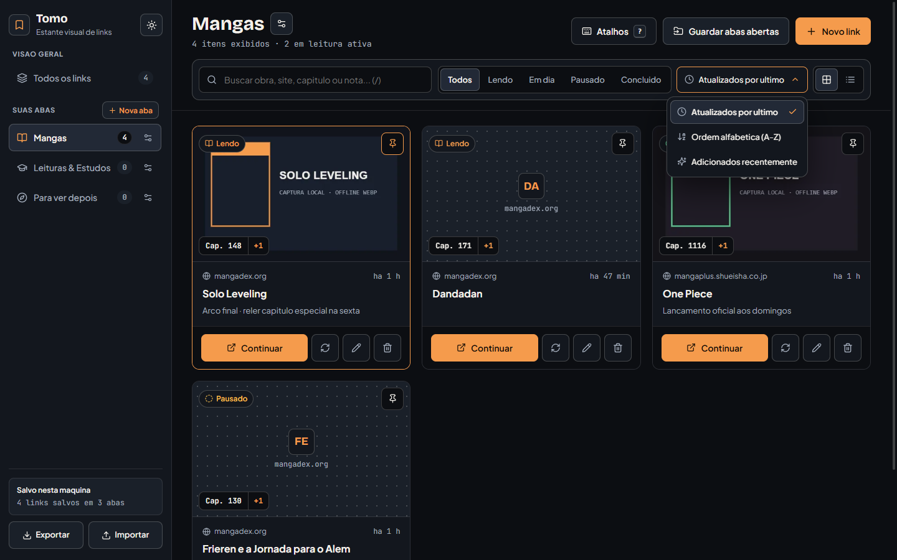
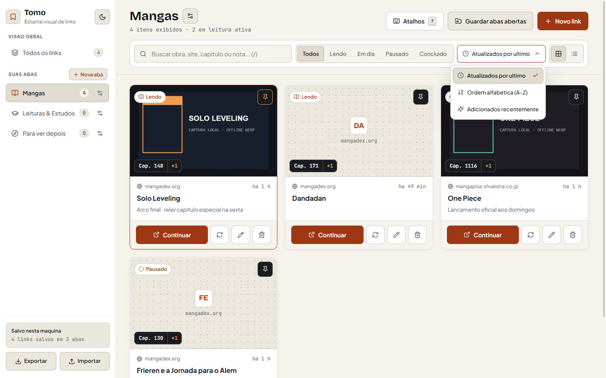
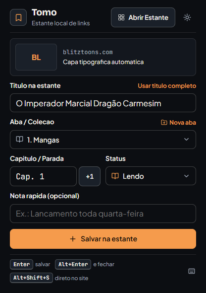

# Tomo · Estante Visual de Links

Extensao para **Google Chrome**, **Microsoft Edge** e **Brave** (Manifest V3) criada para salvar e organizar sites, mangas, leituras e referencias separados por abas visuais, sem precisar deixar dezenas de abas abertas consumindo memoria.

Tudo fica salvo **100% no seu proprio computador** (`IndexedDB` local), sem conta, sem nuvem externa e com suporte completo a **Exportar** e **Importar** backup em arquivo `.json`.

> **Download direto para instalar:** [**Baixar ultima versao (.zip) em Releases**](https://github.com/LucasCamy/tomo/releases/latest)

---

## Previa da Extensao

### Estante completa (Tema Escuro e Tema Claro)




### Popup rapido na barra do navegador


---

## Como instalar (passo a passo rapido, sem precisar programar)

Funciona no **Google Chrome**, **Brave**, **Microsoft Edge**, **Opera** e **Vivaldi** no computador:

### 1. Baixe e extraia o pacote pronto
1. Acesse a pagina de [**Releases do Tomo**](https://github.com/LucasCamy/tomo/releases/latest).
2. Em **Assets** (no fim da nota da versao), clique em **`tomo-chrome-v1.2.0.zip`** (ou a versao mais recente) para baixar.
3. Clique com o botao direito no arquivo `.zip` baixado e escolha **Extrair Tudo...** (*Extract All*).
4. Salve a pasta extraida em um local fixo do seu PC (por exemplo: `Documentos/Tomo`).
   > **Importante:** nao apague nem mova essa pasta depois de instalar, pois o navegador carrega a extensao diretamente dela.

### 2. Carregue no seu navegador
1. Abra uma nova aba, digite o endereco abaixo conforme seu navegador e aperte `Enter`:
   - **Chrome:** `chrome://extensions/`
   - **Edge:** `edge://extensions/`
   - **Brave:** `brave://extensions/`
2. Ative a chave **Modo do desenvolvedor** (*Developer mode*), que fica no canto superior direito (ou esquerdo, no Edge).
3. Clique no botao **Carregar sem compactacao** (*Load unpacked*).
4. Selecione a pasta que voce extraiu (certifique-se de selecionar a pasta que tem o arquivo `manifest.json` diretamente dentro dela).

### 3. Fixe o icone na barra para usar em 1 clique
1. Clique no icone de **quebra-cabeca** (Extensoes) no canto superior direito do navegador.
2. Clique no icone de **alfinete (Fixar)** ao lado de **Tomo · Estante Visual de Links**.
3. Pronto! Agora basta clicar no icone do **Tomo** em qualquer site para salvar ou apertar `Alt+Shift+S`.

---

## Como atualizar quando sair versao nova (sem perder seus links)

Voce pode conferir e aplicar atualizacoes direto pela propria Estante do Tomo:

1. Abra a Estante e clique no botao **Atualizar** (no topo) ou **Sincronizar e Atualizar** (no canto inferior esquerdo).
2. Clique em **Verificar nova versao**. Se houver atualizacao, clique no botao **Baixar `tomo-chrome-v*.zip`** que aparece na janela.
3. Extraia os arquivos novos **dentro da mesma pasta** onde voce instalou antes, substituindo os arquivos antigos.
4. Volte na janela da Estante e clique em **Aplicar e recarregar extensao** (nao precisa nem abrir `chrome://extensions/`).
   - Como a pasta continua no mesmo caminho, o navegador mantem o mesmo ID da extensao e **todos os seus mangas, capas e abas continuam salvos intactos**.

---

## Principais Recursos

- **Salvamento e reconhecimento inteligente:**
  - Captura automatica da capa do site (`og:image`) ou miniatura visual comprimida da aba (WebP local).
  - Detecta automaticamente o capitulo ou episodio pelo titulo/URL (`Cap. 142`, `Cap. 375.5`, `Ep. 08`).
  - Se voce ja salvou uma obra no `Cap. 142` e abrir o popup lendo o `Cap. 148`, o Tomo reconhece a obra e oferece **Atualizar parada** em 1 clique sem duplicar card.
  - Opcao **Salvar e fechar** para guardar onde parou e ja fechar a aba do navegador na hora.
- **Estante visual organizada por abas:**
  - Crie, renomeie, escolha icones e reordene quantas abas/colecoes quiser (`Mangas`, `Leituras & Estudos`, `Para ver depois`, etc.).
  - Botao `+1` direto na capa do card para somar capitulos rapidamente.
  - **Guardar abas abertas:** importa varias abas abertas da janela do Chrome de uma so vez e fecha todas automaticamente.
  - Busca instantanea, filtros por status (`Lendo`, `Em dia`, `Pausado`, `Concluido`), ordenacao, modo Galeria ou Compacto e alternancia entre **Tema Escuro** e **Tema Claro**.
- **Backup 100% local e sincronizacao automatica (`.json`):**
  - Vincule um arquivo `tomo-backup.json` fixo no seu computador (por exemplo em `Documentos`, OneDrive ou Google Drive) para que toda mudanca na Estante atualize esse arquivo sozinha, sem gerar copias repetidas em `Downloads`.
  - Exporte ou importe backups a qualquer momento escolhendo entre **Mesclar** ou **Substituir**.
- **Verificacao de nova versao em 1 clique:**
  - Confira direto na Estante se saiu versao nova em GitHub Releases e recarregue a extensao em 1 clique apos atualizar a pasta.

---

## Atalhos de Teclado

### Em qualquer site no navegador (Globais)

| Atalho padrao | O que faz |
|---|---|
| `Alt+Shift+S` | Salva o site atual (ou atualiza o capitulo se ja estiver salvo) sem abrir o popup |
| `Alt+Shift+X` | Salva/atualiza o site atual e ja fecha a aba |
| `Alt+Shift+Q` | Abre o Popup rapido do Tomo |
| `Alt+Shift+O` | Abre ou foca a Estante completa |

> Voce pode personalizar qualquer tecla global acessando `chrome://extensions/shortcuts`.

### Dentro do Popup rapido

| Atalho | O que faz |
|---|---|
| `Enter` ou `Ctrl+Enter` | Confirma o salvamento ou atualizacao da parada |
| `Alt+Enter` | Salva/atualiza e fecha a aba atual |
| `Alt+Seta Cima / Baixo` | Soma `+1` ou diminui `-1` no numero do capitulo |
| `Alt+1` ate `Alt+9` | Escolhe rapidamente a aba de destino |

### Dentro da Estante

| Atalho | O que faz |
|---|---|
| `/` | Foca o campo de busca |
| `N` | Abre o modal de Novo link |
| `G` | Abre o modal de Guardar abas abertas |
| `0` | Mostra `Todos os links` |
| `1` ate `9` | Alterna entre suas abas na ordem da barra lateral |
| `?` | Abre o guia completo de atalhos |

---

## Privacidade e Seguranca

- **Dados 100% locais:** nenhum historico, URL, nota ou imagem sai da sua maquina. A consulta de nova versao no GitHub ocorre apenas se voce clicar em **Verificar nova versao**, sem enviar credenciais nem links salvos (veja [ADR-0001](docs/adr/0001-sincronizacao-local-e-verificacao-de-atualizacao.md)).
- **Validacao local:** backups `.json` importados passam por validacao de estrutura e bloqueio de esquemas inseguros (aceitando apenas links `http://` e `https://`).

---

## Para Desenvolvedores (rodar pelo codigo-fonte e publicar Releases)

Pre-requisito: [Node.js 20+](https://nodejs.org/).

```bash
# 1. Clonar o repositorio e instalar dependencias
git clone https://github.com/LucasCamy/tomo.git
cd tomo
npm install

# 2. Rodar testes unitarios e verificacao de contraste WCAG AA
npm test
npm run verify:contrast

# 3. Gerar a pasta dist/ pronta para carregar em chrome://extensions
npm run build

# 4. Gerar tambem o pacote release/tomo-chrome-vX.Y.Z.zip
npm run pack
```

### Como lancar uma nova versao publica no GitHub Releases
O repositorio ja possui **GitHub Actions** configurado em [`.github/workflows/release.yml`](.github/workflows/release.yml):
1. Atualize o campo `"version"` em `public/manifest.json` e `package.json` (ex.: `"1.2.0"`).
2. Faca commit e crie uma tag comecando com `v`:
   ```bash
   git add .
   git commit -m "chore: prepara versao 1.2.0"
   git tag v1.2.0
   git push origin main --tags
   ```
3. O GitHub vai rodar os testes automaticamente, gerar o `.zip` e publicar a nova pagina em **Releases** pronta para seus amigos baixarem!
